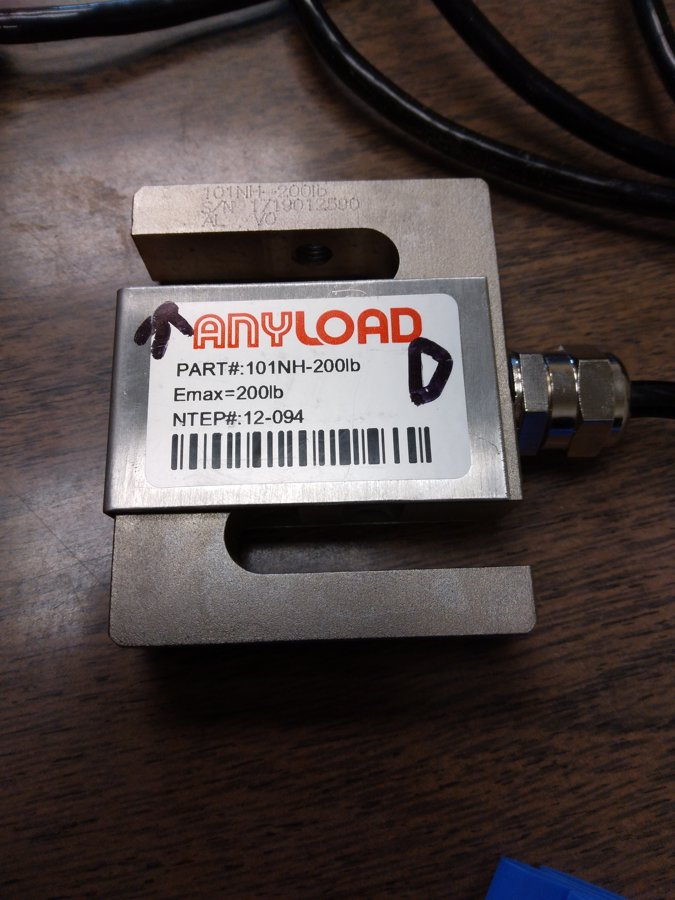
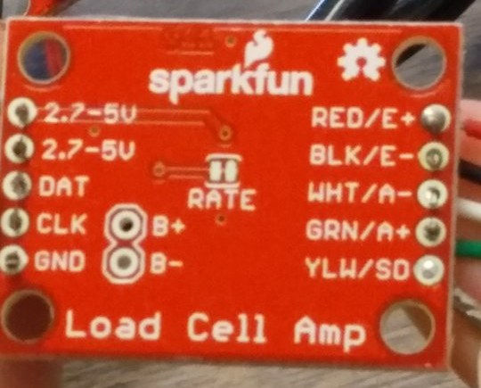
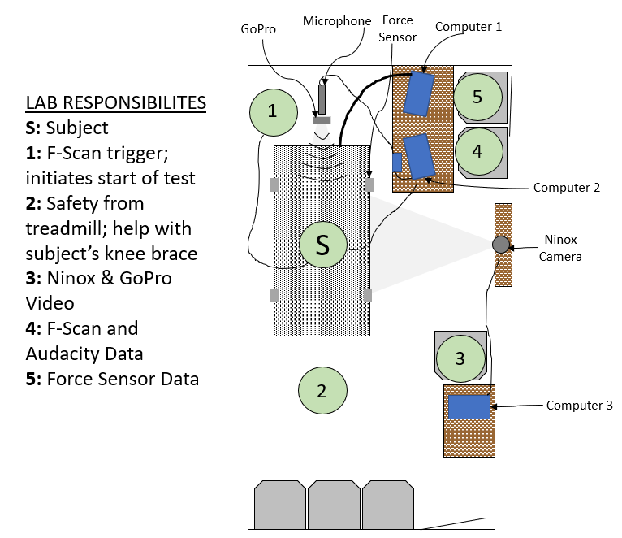
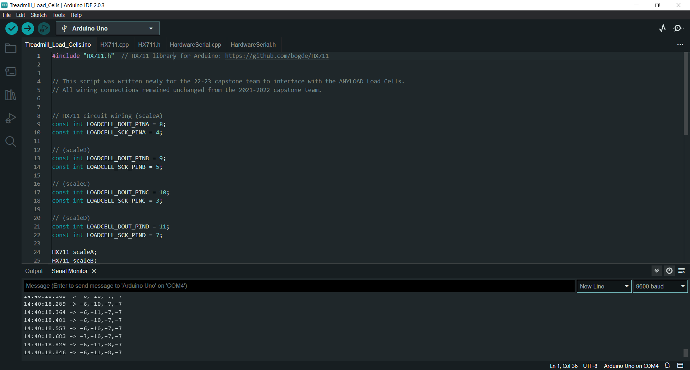
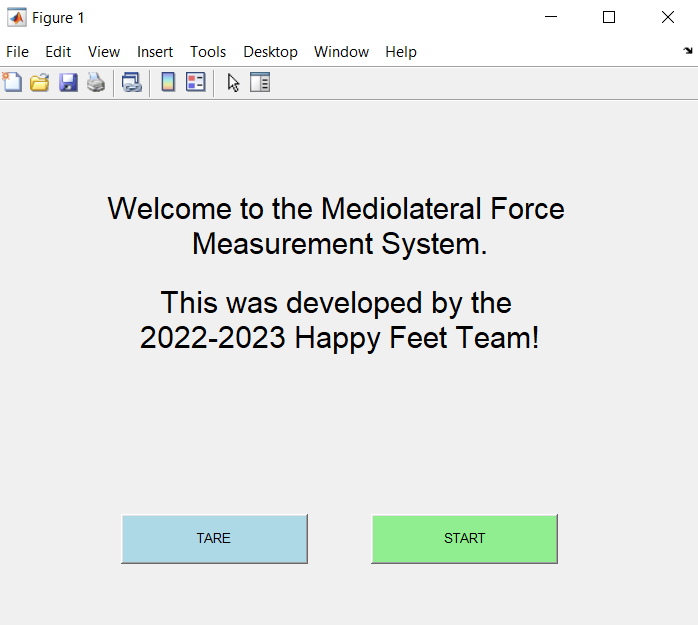

# Acoustic Biomechanics: Senior Capstone (Grove City College, 2022-2023)

Code from the Grove City College **Acoustic Biomechanics** engineering capstone. The project's goal is to provide and validate clinically useful gait parameters from acoustic measurements, for example quantifying a gait impairment or an injury recovery from the sound of someone's footsteps. It is sponsored by Highmark Health Data Analytics and spans the Mechanical Engineering, Electrical Engineering, Exercise Science and Computer Science departments.

This repo contains the software for the **mediolateral force measurement system** the 2022-2023 team designed, built and installed on a treadmill.

## My role

- Worked on the project from Nov 2021 to May 2023.
- Spring 2022 (junior year): undergraduate independent research on the project.
- Fall 2022 and Spring 2023 (senior year): senior capstone lead.
- Wrote the data-acquisition GUI and the force-analysis script in this repo.

## What's in here

```
arduino/Treadmill_Load_Cells/   Arduino sketch: reads 4 load cells through HX711 amplifiers, streams over USB serial
matlab/data_acquisition/        ML_Force_GUI.m: MATLAB GUI that tares, live-plots and logs each trial to CSV (walkthrough with screenshots)
matlab/data_analysis/           ML_Force_Analysis.m and related scripts: per-step peak forces, left vs right, F-Scan stance cuts, group charts
acoustic_fscan_analysis/        Footstep-acoustics + F-Scan pipeline: stance segmentation, envelope cut-outs, PCA (see its README)
docs/images/                    Screenshots and photos used in the READMEs
```

## The measurement system

Why mediolateral (side-to-side) force? It is a known indicator of balance and stability in gait, and instrumented treadmills that measure it are far too expensive for a project like this. The team built a lower-cost system instead.

- Four ANYLOAD 101NH S-beam load cells, one at each corner of the base under a TrackMaster TMX428 treadmill
- One HX711 24-bit ADC board per load cell
- An Arduino Uno R3 connected to the lab computer over USB

<table>
<tr>
<td></td>
<td></td>
</tr>
<tr>
<td>An ANYLOAD 101NH-200lb S-beam load cell (this one is marked "D").</td>
<td>A SparkFun Load Cell Amp (HX711) board, showing its pin labels.</td>
</tr>
</table>

The two load cells on each side of the treadmill behave like a simply supported beam, so the analysis adds the front and back signals for each side to get total left and right mediolateral force.

Sensor labels used throughout the code:

| Sensor | Position | HX711 DOUT pin | HX711 SCK pin |
|---|---|---|---|
| A | front left | 8 | 4 |
| B | front right | 9 | 5 |
| C | back right | 10 | 3 |
| D | back left | 11 | 7 |

```
load cells -> HX711 x4 -> Arduino Uno --USB serial, 9600 baud--> MATLAB GUI -> trial CSV -> analysis script
                          Treadmill_Load_Cells.ino              ML_Force_GUI.m              ML_Force_Analysis.m
```

### Test setup in the lab

The force system ran alongside the project's other measurements. The diagram shows the treadmill with the microphone, GoPro and Ninox cameras, the force sensors and three computers, plus the five team roles during a test (F-Scan trigger, safety, video, F-Scan and Audacity data, force sensor data).



## Quick start

**1. Arduino.** Install the [HX711 library](https://github.com/bogde/HX711) (bogde), open `arduino/Treadmill_Load_Cells/Treadmill_Load_Cells.ino` in the Arduino IDE, and upload it. The sketch waits for text commands from MATLAB: `START` begins streaming, `TARE` re-zeros all four cells, `END` stops. While streaming it prints one line per reading: `A,B,C,D`, as in the Serial Monitor below.



**2. Record a trial.** In `ML_Force_GUI.m`, change the COM port (`serialport("COM4",9600)`) to match your Arduino, then run it. Needs MATLAB R2019b or newer.
- Enter a trial name as `<subject code>_<condition>`, for example `S23AA_L40`. The conditions used in testing were `Norm` (unrestrained), `L40`, `L20`, `R40` and `R20` (knee brace on the left or right leg, set to 40 or 20 degrees of flexion).
- Press **TARE** with the belt stopped and nobody on the treadmill (takes about 5 seconds), then **START**. The live plot shows all four sensors.
- Press **STOP** to end the test. Data is logged to `<name>.csv` as it streams, with columns: time (s), A, B, C, D (pounds).



See [`matlab/data_acquisition`](matlab/data_acquisition) for the full walkthrough with screenshots.

**3. Analyze.** Convert the CSV to `.xlsx`, open `ML_Force_Analysis.m` (the other scripts are described in [`matlab/data_analysis`](matlab/data_analysis)), set `filename` and `subjectWt` (the example values in the file are placeholders), and run it. It needs the Signal Processing Toolbox. The script:
- drops everything after 90 seconds (trials are 90 s)
- replaces rogue single-sample spikes outside a 0-25 lbf window
- plots all four sensors, then finds the peak force of every step with `findpeaks` (`MinPeakDistance` = 10 samples, tuned by trial and error) and reports the average and standard deviation of the peaks
- sums front and back sensors per side, plots left and right, and reports which side had the larger average peak and the difference
- reports the average peak mediolateral force as a percentage of body weight

## Things to know

- **Validation:** the target was accuracy of 5 N or better, and the team concluded the system met it. Methods were a zero check, 500 g / 1 kg / 2 kg test weights, a Tekscan FlexiForce sensor placed in line with a load cell, and a spring scale pulling the treadmill.
- **Units:** the Arduino sketch's comment says its calibration factor (`0.01377888`) outputs pounds, but `ML_Force_GUI.m` treats the incoming values as grams and divides by 453.592 to get pounds. Verify the units before relying on absolute numbers.
- **Zero drift:** the cells did not always return exactly to zero after a trial (about half a pound), which is why the GUI has a TARE button and the team re-tared between trials.
- **Treadmill motor:** the motor adds a small periodic force to the signal (peaks around 1.5 lb at 2 mph). This was not removed in post-processing.
- **Sampling:** the sample rate is set by the serial loop and is not perfectly uniform. The analysis script prints the mean sample interval for each trial.
- **Peak finding:** not every step's peak is always found. Check the plots, especially the arrows marking peaks, before trusting a result.
- **No automated tests:** these are lab scripts used for the 2023 subject tests, so there is no test suite.

## Data and privacy

Human-subject testing for this project was done under IRB approval. **No subject data, recordings or paperwork are in this repo**, and the `.gitignore` blocks common data file types (CSV, XLSX, WAV, AVI, MAT, and so on). Subject codes such as `S23AA` are coded identifiers. The file names and body weight in the scripts are placeholders. The images in `docs/images/` are screenshots of software, photos of hardware and a lab diagram; one screenshot (the GUI live plot) shows about 15 seconds of raw load-cell readings with no subject identifier.

## Team and credits

2022-2023 capstone team: Matthew Grazulis, Jesse Greyshock, Gina Kim, Rachael Wallace. Project advisor: Geo. A. Richards, PhD. Also thanks to Luke Johnson (machine shop advisor) and Joshua Parris (sensor data acquisition). Sponsor: Highmark Health.

The Arduino sketch uses the HX711 library by bogde. The acoustic/F-Scan scripts descend from code by Aaron Hammer-Huber that Dr. Richards revised and I extended; details are in that folder's README.
