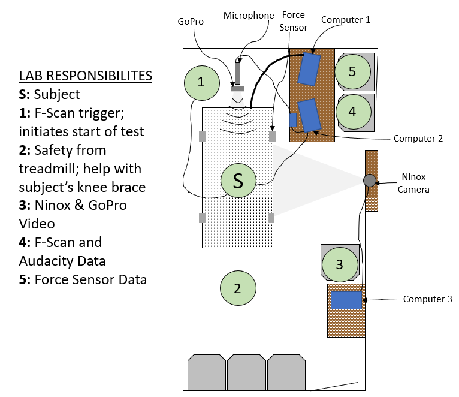

# Acoustic + F-Scan analysis

MATLAB scripts that line up the sound of footsteps with plantar-pressure data and look for repeatable patterns. For each step, the F-Scan in-shoe sensors say when the foot was on the ground, and that window is cut out of the acoustic envelope. The cut-outs are then compared across steps and run through principal component analysis (PCA).

The overall approach (RMS acoustic envelope, stance segmentation from F-Scan center-of-force velocity, ensemble averaging of footfalls) is described in:

> Buxton J., Shields K.J., Greyshock J.T., Ramsey J., Adams C., Richards G.A. *Investigation of Acoustic Signals for Gait Analysis.* Biomechanics 2025, 5(1), 7. https://doi.org/10.3390/biomechanics5010007

The paper does not publish its code, and these scripts are the Spring 2023 capstone versions. I can't tell from file names alone which version produced the paper's figures, so don't treat these as the paper's exact code.

## How the data is collected

For each trial the subject walks or runs on the treadmill while a microphone records the footsteps and the F-Scan in-shoe sensors record plantar pressure. Force sensors and cameras run alongside. The lab layout and the team's roles during a test are in the diagram below. Example results and figures are in the paper above (they are not copied here).

## Credit

This code has a lineage, and the original header comments in every script are kept as they were:
- Original code by **Aaron Hammer-Huber** (Feb 2022)
- Revised, commented and extended by **Dr. Geo Richards**
- Modified by **Jesse Greyshock** for center-of-force-velocity data, 90-second trials and the PCA step (2022-2023)

Signal-processing methodology credit in the paper above: J.T. Greyshock.

## The scripts

| Script | Role | Trial length | Envelope |
|---|---|---|---|
| `chop_envelopes_V104_60s_peak.m` | Step 1: chop the acoustic envelope into one extended stance per footstep | 60 s (reads 24,000 F-Scan samples) | `peak`, 400 samples |
| `chop_envelopes_90s_rms.m` | Step 1: same job for the 90-second trials used in Spring 2023 | 90 s (reads 36,000 F-Scan samples) | `rms`, 400 samples |
| `plot_left_envelopes_pca_V106.m` | Step 2, left foot: overlay stances, trim to the shortest, save, standardize, PCA | n/a | n/a |
| `plot_right_envelopes_pca_V106.m` | Step 2, right foot: same, appends to the same `.mat` | n/a | n/a |
| `step_detection_velocity_vs_force.m` | Standalone (April 2022): finds foot strikes and lifts from the COF-velocity export and from the force export, and plots both so you can compare | 60 s | n/a (no acoustic processing) |

The two Step 1 scripts differ only in trial length and envelope type (plus small edits noted in their headers). Pick the one that matches your data.

`step_detection_velocity_vs_force.m` is separate from that pipeline. It is the script behind the choice of COF velocity (rather than force) for finding stance, and its header credits Jesse Greyshock as its creator (4-16-2022). It needs both the "VT" and the force ("F") F-Scan export for each foot.

## Inputs

- **Audio:** one `.wav` per trial at 44.1 kHz. For the Spring 2023 capstone data it was filtered beforehand (a noise-reduction filter, then a 1,000 Hz low-pass, per the project's data procedure manual). Only the first channel is used.
- **F-Scan:** the center-of-force *velocity total* ("VT") ASCII export, **one file per foot**, recorded at 400 Hz. Data starts at row 31, column E. The long comment at the top of each Step 1 script walks through the export in the F-Scan software (it takes 10 minutes or more per foot).
- The audio and the two F-Scan files must be from the same trial, and left and right must be assigned correctly in `filelocationL` / `filelocationR`.

## How to run

1. In a Step 1 script, set `filelocationR`, `filelocationL`, `audiofile`, `subjectWt` and `filenameOUTPUT`. The values in the files are placeholders.
2. Run the Step 1 script. It detects every foot strike and lift, plots the F-Scan signal with the contact markers, and builds the envelope cut-outs (`chopOutLup`, `chopOutRup`, and so on) in the workspace.
3. **In the same workspace**, run `plot_left_envelopes_pca_V106.m`, then `plot_right_envelopes_pca_V106.m`. They are not standalone: they use variables the Step 1 script created. The V104 header says it runs the plotters automatically, but this copy ends after the chopping step, so run them yourself.
4. Outputs: the stance envelopes saved to `filenameOUTPUT` (`Xsto_L`/`Ysto_L` and `Xsto_R`/`Ysto_R`), plus figures of the overlaid envelopes, PCA scores and percent variance explained.

Toolboxes: Signal Processing (`envelope`), Curve Fitting (`smooth`), and Statistics and Machine Learning (`pca`). The paper reports MATLAB R2022b.

## What was cleaned up from the originals

Algorithms and parameters are unchanged. The edits:
- **Live scripts exported to `.m`.** The originals were `.mlx` files, which embed their plots and are not readable on GitHub. The embedded figures can contain subject data, so they were left out.
- **Subject-linked names and values replaced with placeholders:** F-Scan and audio file names (the F-Scan names were derived from subjects' names), subject weight, and an example output name in a comment. A comment pointing at the college's network drive now just names the shared "Reduced Data" folder.
- **One behavior change:** the plotters used to save to a fixed file name (the left one `... Post.mat`, the right one appending to a different file, `... Pre.mat`). Both now save to `filenameOUTPUT`, which is what the V104 header says they were meant to do. If that variable isn't set, they fall back to `TRIAL_OUTPUT.mat`.
- A short header was added to each file. Nothing else was removed, including commented-out code.

## Known quirks

- Plot axis limits are hardcoded (for example `[0 2.5 -4 10]` in the PCA plots), and the first 6 steps are skipped (`Nskip = 6`).
- The two Step 1 scripts use different envelope types (`peak` vs `rms`), and the published paper describes an RMS envelope with a 400-sample window.
- The header comment in `chop_envelopes_90s_rms.m` still talks about 60-second files and 24,000 samples, even though the code reads 36,000 samples (90 s at 400 Hz).
- In `step_detection_velocity_vs_force.m` the header says the velocity data uses a near-zero threshold, but only the right-foot velocity data does (minimum + 1e-8). The left-foot velocity data uses minimum + 2.5, and the force data uses minimum + 5 (right) and minimum + 2.5 (left). There is also a copy-paste slip in the force-data branch that runs only when the right and left strike counts differ: it trims `StrkIndR` where it should trim `StrkIndR2`. Both are left as they were.
- No automated tests. These were research scripts and need data to run.

## Data

No audio, F-Scan exports or `.mat` results are in this repo. The `.gitignore` blocks those file types.
