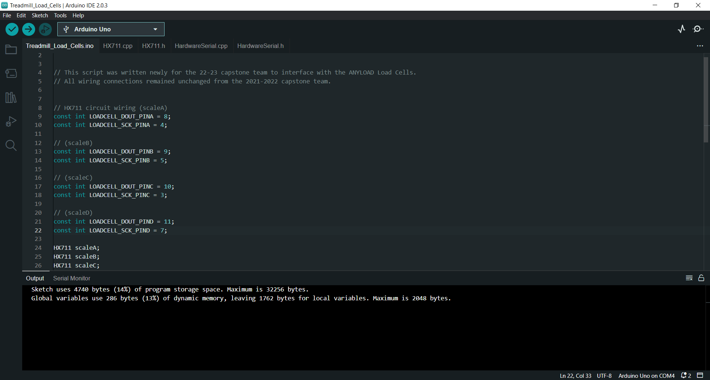
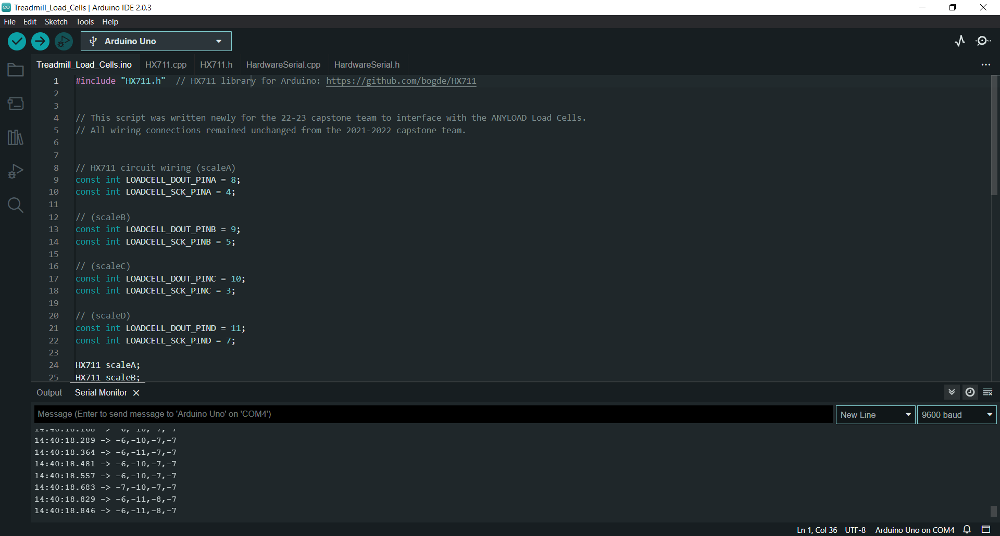
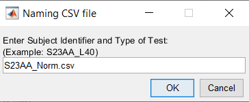
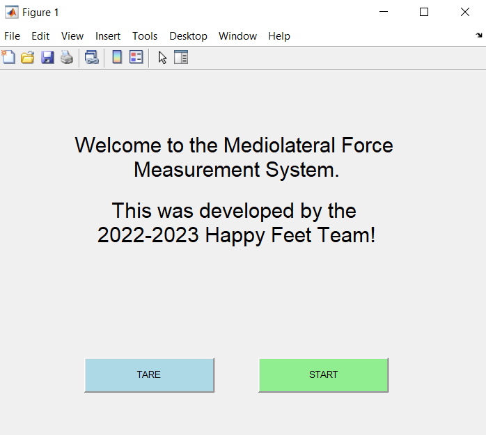
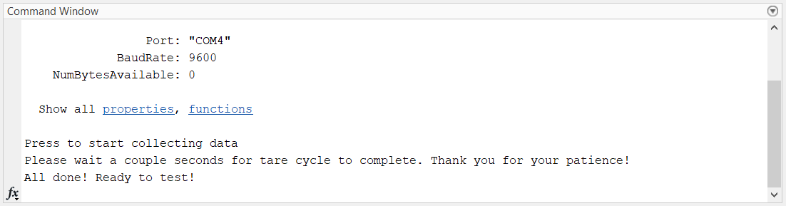
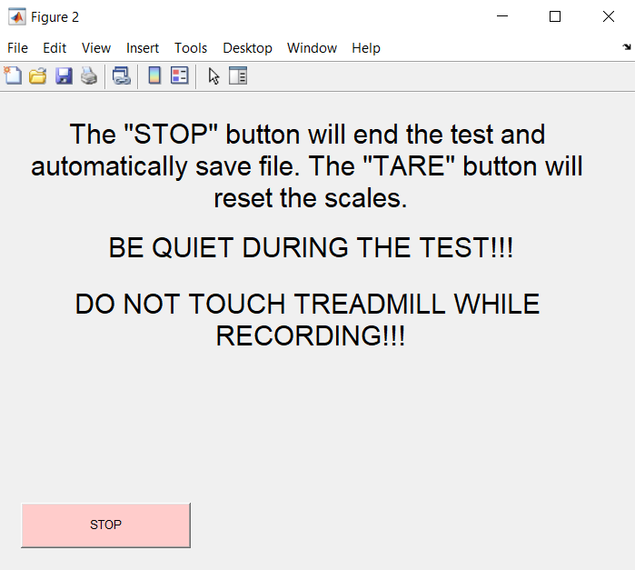
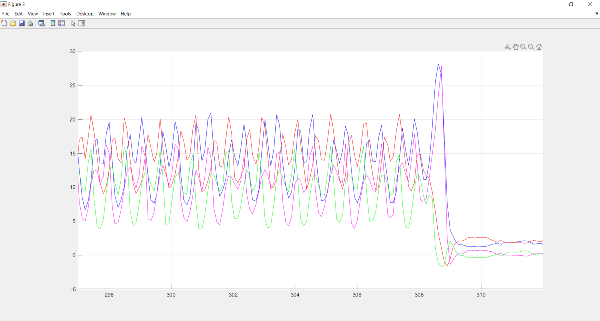

# Data acquisition: `ML_Force_GUI.m`

MATLAB GUI (originally named `BIOMECHblue.m`) that records one treadmill trial from the mediolateral force system: it tares the four load cells, live-plots them, and logs every reading to a CSV. It talks to the Arduino sketch in [`../../arduino/Treadmill_Load_Cells`](../../arduino/Treadmill_Load_Cells). The overall workflow is in the [top-level README](../../README.md).

Needs MATLAB R2019b or newer (`serialport`). Change `serialport("COM4",9600)` to your Arduino's port before running.

## Walkthrough

**1. Upload the Arduino sketch.** Open `Treadmill_Load_Cells.ino` in the Arduino IDE (the screenshots use IDE 2.0.3), pick the Arduino Uno and its port, and upload. With the Serial Monitor at 9600 baud you can check that the sketch streams one `A,B,C,D` reading per line. A serial port can only be open in one program at a time, so close the Serial Monitor before starting the GUI.

**2. Run `ML_Force_GUI.m` and name the trial.** Enter `<subject code>_<condition>`, for example `S23AA_L40`. The conditions used in testing were `Norm`, `L40`, `L20`, `R40` and `R20`. The trial is saved as `<name>.csv` in the current folder.

**3. Tare, then start.** With the belt stopped and nobody on it, press **TARE** (about 5 seconds, progress is printed in the Command Window), then **START**.

**4. Record.** A window with the **STOP** button appears and a live plot opens. The plot shows a 15-second moving window of the four sensors: A (front left) blue, B (front right) red, C (back right) green, D (back left) magenta. Press **STOP** to end the test; the GUI tells the Arduino to stop and closes the windows.

*This screenshot is from a slightly earlier revision: its text also mentions a TARE button, which in the code here is only on the start window.*

*The live-plot screenshot is also from an earlier revision (the current code fixes the y-axis at -5 to 20 and names the figure window after the trial). It shows about 15 seconds of raw readings and carries no subject identifier.*

## Output

One CSV row per reading, written as the data streams in, with columns: time (s), A, B, C, D (pounds, per the GUI's conversion). See "Things to know" in the top-level README about the units. Convert the CSV to `.xlsx` and continue with the scripts in [`../data_analysis`](../data_analysis).
